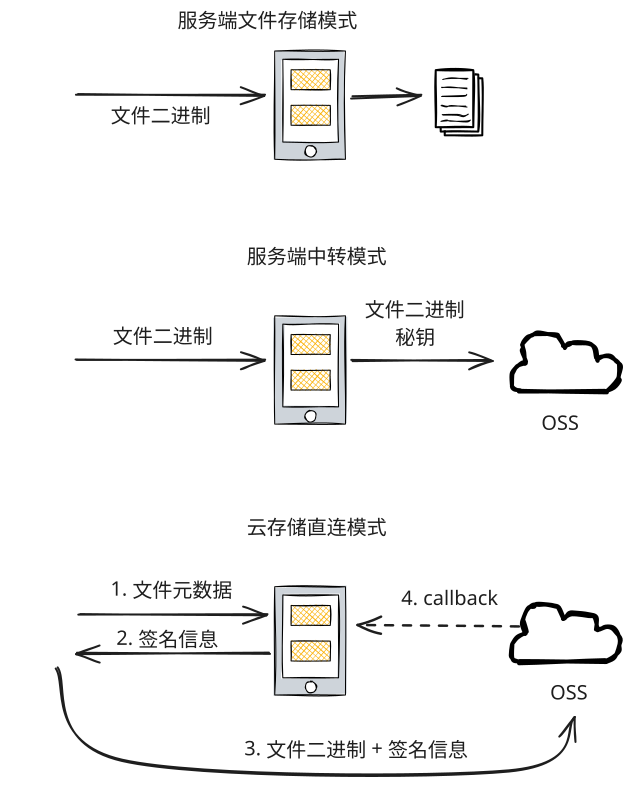

```json
{
    "Version": "1",
    "Statement": [
        {
            "Effect": "Allow",
            "Action": [
                "oss:PutObject",
                "oss:GetObject",
                "oss:DeleteObject"
            ],
            "Resource": [
                "acs:oss:*:*:your-bucket-name",
                "acs:oss:*:*:your-bucket-name/*"
            ]
        }
    ]
}
```

