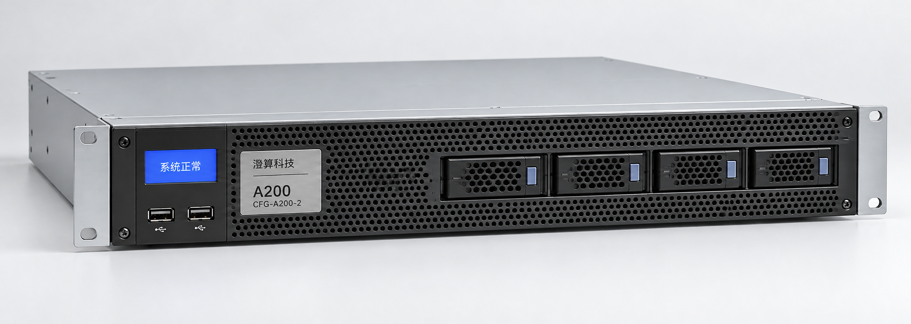
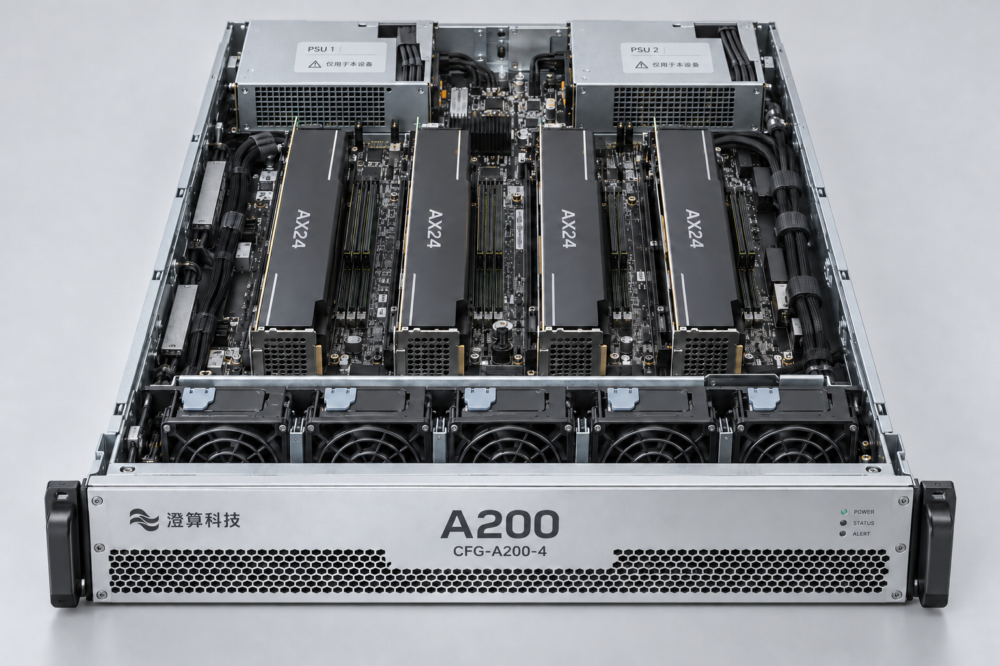

# A200 推理一体机产品与配置说明

文档编号：PROD-001  
版本：1.2  
发布日期：2026-08-01  
负责人：产品部 杜峻  
状态：有效  
阅读范围：销售与售前

## 产品定位

A200 面向企业内部知识问答、文档摘要和业务助手场景。澄算科技提供设备、澄算推理引擎和基础应用控制台，客户在自己的网络中部署。销售应根据实际模型、请求长度和同时处理的请求数选型，不能用员工总数直接推算设备配置。

“A200”是产品系列名称，报价必须写清具体配置编号。A200 两卡版和四卡版不是同一个交付配置。

## 标准配置

| 项目 | A200 两卡版 | A200 四卡版 |
| --- | --- | --- |
| 配置编号 | CFG-A200-2 | CFG-A200-4 |
| 加速卡 | 2 张 AX24 | 4 张 AX24 |
| 单卡显存 | 24 GB | 24 GB |
| 系统内存 | 256 GB | 512 GB |
| 本地存储 | 2 TB 系统盘及 4 TB 数据盘 | 2 TB 系统盘及 8 TB 数据盘 |
| 数据网络 | 双口 10 GbE | 双口 10 GbE |
| 机箱 | 2U | 2U |
| 出厂软件基线 | 澄算推理引擎 3.2.0 | 澄算推理引擎 3.2.0 |

AX24 是本公司资料中使用的加速卡型号标识。显存之和只是配置属性，不能单凭它确认某个模型在特定上下文长度下可运行。

## 产品外观与内部照片

以下照片用于销售选型和部件位置沟通。两卡版正面和四卡版内部对应不同配置，核对设备时应同时查看配置铭牌。

## 标准交付内容

设备价格包含上述硬件、一套推理引擎运行许可、基础知识库应用和三年标准维保。基础知识库应用包含文档导入、向量检索和对话界面，不包含客户现有业务系统的定制对接。

标准软件包包含工务通 3.0 标准连接器 COMP-GWT-S30。工务通 2.3 需要另购旧版适配器 COMP-GWT-L23，兼容组合见 PROD-003 和 TEST-003。

## 选型注意事项

星语 32B Q4 的不同并发和上下文条件见 TEST-001。宣传中不得把整机合计输出速率写成每个用户的输出速率，也不得把两卡版测试结果归到四卡版名下。

客户提出 70B 模型、非量化模型或超长上下文要求时，应先确认模型版本、精度和测试条件。A200 的现有测试资料不足以承诺这些场景，销售应提交专项验证申请。

## 服务与交付

三年标准维保包含远程排查和硬件故障处理。标准服务时段为工作日 09:00 至 18:00，受理后四个工作小时内首次响应；首次响应不是故障修复承诺。定制集成、客户业务数据迁移和全天候现场值守不在标准维保范围内。

满足商务付款条件并完成配置确认后，常规备货配置预计十五个工作日发货。合同日期由商务核对库存后确认。

相关资料：PROD-003、TEST-001、TEST-003、BIZ-002。
