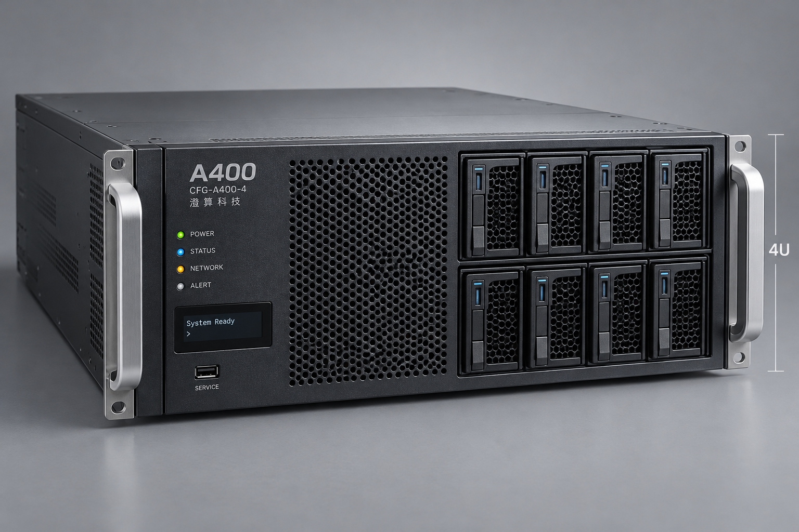
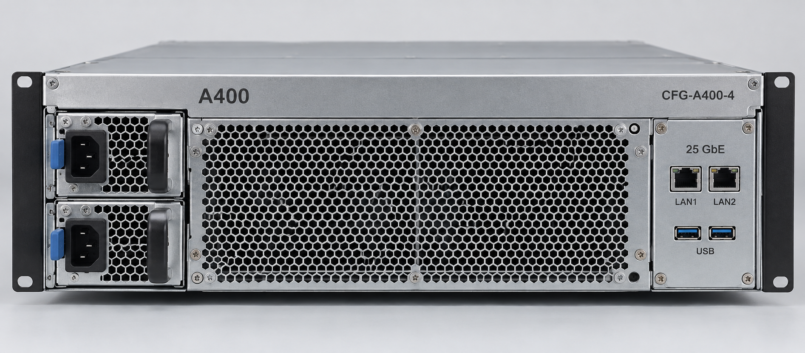

# A400 推理一体机产品与配置说明

文档编号：PROD-002  
版本：1.1  
发布日期：2026-08-01  
负责人：产品部 杜峻  
状态：有效  
阅读范围：销售与售前

## 产品定位

A400 用于客户希望验证较大模型，或需要更高请求处理能力的项目。现阶段可对外引用的星语 70B 结果限定为 Q4 版本，不能据此承诺 FP16 版本的性能。

## 交付配置

| 项目 | 标准配置 |
| --- | --- |
| 配置编号 | CFG-A400-4 |
| 加速卡 | 4 张 AX48 |
| 单卡显存 | 48 GB |
| 系统内存 | 1 TB |
| 本地存储 | 2 TB 系统盘及 16 TB 数据盘 |
| 数据网络 | 双口 25 GbE |
| 机箱 | 4U |
| 出厂软件基线 | 澄算推理引擎 3.2.0 |

设备包含推理引擎运行许可、基础知识库应用、工务通 3.0 标准连接器 COMP-GWT-S30 和三年标准维保。工务通 2.3 旧版适配器 COMP-GWT-L23、专项集成和延长维保需要单独报价。

## 产品外观与接口照片

正面照片用于确认机箱外观与盘位布局，后面板照片用于识别接口和部件位置。交付配置仍以本产品说明和正式配置单为准。

## 可以引用的性能资料

TEST-002 包含星语 70B Q4 在不同上下文和并发条件下的测试。方案中引用结果时，必须同时写明模型、量化、引擎版本、输入输出长度、并发数及测试编号。

“支持部署某模型”表示已有对应运行记录，不表示任意业务负载都达到客户验收要求。TEST-002 没有星语 70B FP16 的结果，也没有八个并发请求、16000 tokens 输入的结果。

## 服务与采购

标准维保时段及首次响应口径与 A200 相同：工作日 09:00 至 18:00，四个工作小时内首次响应。常规配置在商务付款条件和配置确认完成后，预计二十五个工作日发货；以商务确认的交期为准。

当前标准价格见 BIZ-002。销售不得将未审批折扣、现场实施服务或尚未验证的第三方软件兼容性写成标准交付内容。

相关资料：PROD-003、TEST-002、BIZ-002、SOL-003。
