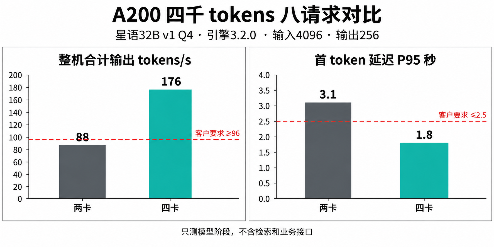

# A200 星语 32B 性能测试报告

文档编号：TEST-001  
版本：1.0  
测试日期：2026-08-06  
发布日期：2026-08-08  
负责人：测试组 陈砚  
状态：已评审  
阅读范围：销售与售前

## 测试环境

本次对比 CFG-A200-2 和 CFG-A200-4。模型为星语 32B v1，采用 Q4 权重量化，推理引擎为 3.2.0。全部结果均为纯文本生成，不包含向量检索、业务连接器、重排、网络传输和应用页面的额外时间。

每个条件使用相同的合成输入集合，固定生成 256 个 tokens，预热后运行三轮，每轮五分钟。输入长度按模型 tokenizer 计数；2048 和 4096 表示输入 tokens 数，不是中文字数。

## 两卡版测试结果

以下全部为 CFG-A200-2、星语 32B v1 Q4、引擎 3.2.0、输出 256 tokens 的结果。

| 测试编号 | 输入长度 tokens | 同时处理的请求数 | 整机合计输出 tokens/s | 首 token 延迟 P95 秒 |
| --- | --- | --- | --- | --- |
| A2-2K-4 | 2048 | 4 | 92 | 1.4 |
| A2-2K-8 | 2048 | 8 | 104 | 2.1 |
| A2-4K-8 | 4096 | 8 | 88 | 3.1 |
| A2-4K-16 | 4096 | 16 | 94 | 6.0 |

## 四卡版测试结果

以下全部为 CFG-A200-4、星语 32B v1 Q4、引擎 3.2.0、输出 256 tokens 的结果。

| 测试编号 | 输入长度 tokens | 同时处理的请求数 | 整机合计输出 tokens/s | 首 token 延迟 P95 秒 |
| --- | --- | --- | --- | --- |
| A4-2K-8 | 2048 | 8 | 188 | 1.2 |
| A4-2K-16 | 2048 | 16 | 212 | 2.2 |
| A4-4K-8 | 4096 | 8 | 176 | 1.8 |
| A4-4K-16 | 4096 | 16 | 166 | 4.2 |

## 结果解释

表中的输出速率是所有请求输出速率之和。例如 A2-2K-8 的 104 tokens/s 不是八个请求各有 104 tokens/s。报告也没有保证各请求均匀分配到相同速率。

首 token 延迟 P95 表示本次测试中 95% 的请求在该时间内开始返回第一个 token，不代表全部请求的完整回答时间。

A200 四卡版在 2048 tokens、16 个同时处理的请求下达到 212 tokens/s，但输入增加到 4096 tokens 后，16 请求条件的首 token 延迟为 4.2 秒。选型时不能只挑吞吐量最大的那一行。

## 客户条件下的对比图

下图对照华辰当前模型阶段指标，数据取自本报告的同一输入长度和并发条件。图中的参考线表示客户要求，不能用作其他客户的默认验收条件。

## 验收边界

客户业务是否达标，仍需用相同模型和负载口径验证完整应用。特别是包含检索和业务接口时，应在模型阶段指标之外补充端到端测量。

相关资料：PROD-001、CUST-001、CUST-002、SOL-002。
