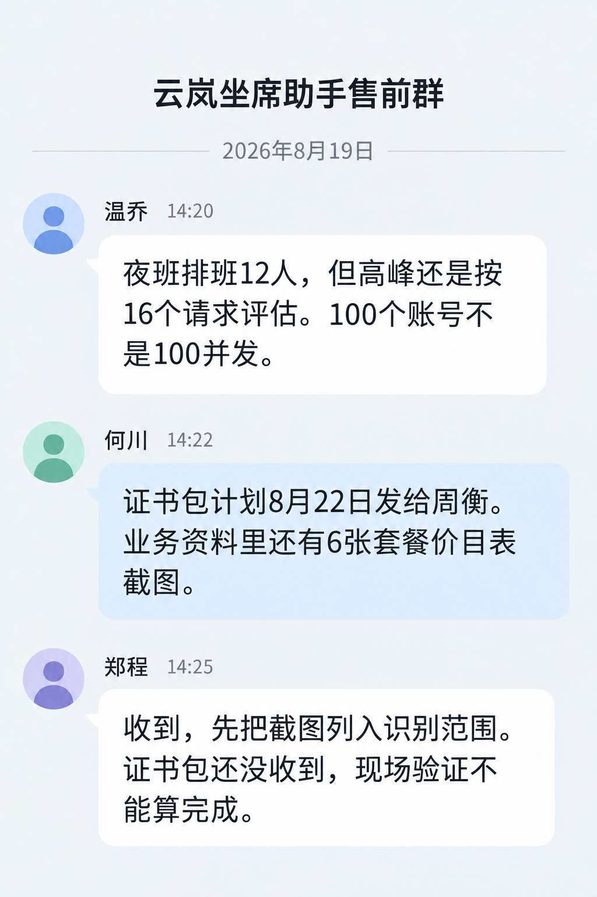

# 云岚客服坐席助手商机与需求记录

文档编号：CUST-002  
版本：1.0  
记录日期：2026-08-13  
补充沟通日期：2026-08-19  
负责人：销售 郑程  
状态：售前评估中  
阅读范围：销售与售前

## 商机信息

客户编号 C-YL，客户名称云岚客服，内部简称“云岚”。商机编号 OPP-YL-01。客户为多家零售企业提供客服服务，希望坐席在接听过程中快速查询业务规则和推荐答复。

运营主管温乔提出需求，IT 主管何川确认接入条件，采购负责人蒋钧评估价格。销售负责人郑程，售前负责人周衡。

## 需求与现有系统

一百名坐席需要登录账号，预计高峰同时处理十六个模型请求。日常使用星语 32B v1 Q4，输入 2048 tokens、输出 256 tokens；模型阶段整机合计输出速率要求不低于 200 tokens/s，首 token 延迟 P95 不高于 2.5 秒。

客户使用工务通 3.0，要求使用标准连接器，不接受额外维护旧版适配器。项目预算为 45 万元，部署在客户内网。现有网络代理与证书还未提供给售前。

## 选型讨论

周衡建议将 CFG-A200-4 作为首轮验证候选，使用 COMP-GWT-S30 2.0 和引擎 3.2.0。TEST-001 中 A4-2K-16 的结果符合日常模型阶段指标，TEST-003 有该组合的实验室接口记录。项目尚未验证完整坐席系统，也未签订采购合同。

温乔提出“大客户规则可能要放四千 tokens”。售前查阅 A4-4K-16 后发现，在 4096 tokens、十六请求条件下，合计输出为 166 tokens/s，首 token 延迟 P95 为 4.2 秒，不满足当前指标。是否限制长请求、拆分规则或改用其他配置，需单独评审，不能直接承诺全部请求达标。

## 客户异议

客户在销售资料里看到“支持百人团队”，因此询问是否可以保证一百人同时生成。郑程已说明该措辞不能替代并发测试；客户尚未确认是否会增加验收并发数。

## 售前群补充沟通

以下为 2026-08-19 项目群的补充沟通记录，用于核对客户说法和资料准备状态。计划发送的材料需实际收到后再登记完成。

相关资料：TEST-001、TEST-003、PROD-001、SALES-002。
