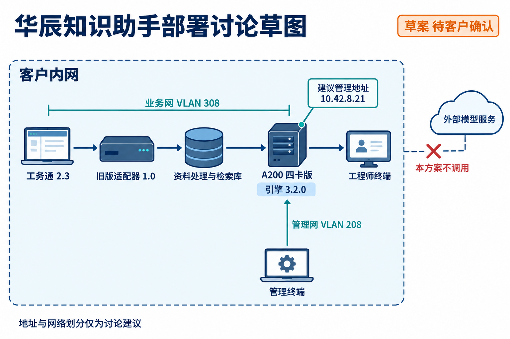

# 华辰精工知识助手八月选型评审

文档编号：SOL-002  
版本：1.0  
评审日期：2026-08-15  
负责人：售前 周衡  
状态：内部评审通过 客户验收未完成  
阅读范围：销售与售前

## 评审依据

本次依据 CUST-001 八月需求：星语 32B v1 Q4、4096 tokens 输入、256 tokens 输出、八请求，模型阶段合计输出不低于 96 tokens/s，首 token 延迟 P95 不高于 2.5 秒。客户保留工务通 2.3，总预算 42 万元。

## 配置比较

| 候选配置 | 对应测试 | 合计输出 tokens/s | 首 token 延迟 P95 秒 | 模型阶段判断 |
| --- | --- | --- | --- | --- |
| CFG-A200-2 | TEST-001 的 A2-4K-8 | 88 | 3.1 | 两项指标均未达到 |
| CFG-A200-4 | TEST-001 的 A4-4K-8 | 176 | 1.8 | 两项实验室指标达到 |

不能用 A2-2K-8 的 104 tokens/s、2.1 秒替代客户四千 tokens 条件。该差异是此次更换配置的直接原因。

## 推荐方案

推荐 CFG-A200-4、推理引擎 3.2.0、星语 32B v1 Q4、COMP-GWT-L23 1.0，并安排一次标准集成。TEST-003 有该配置读取工务通 2.3 的实验室记录。

客户网络证书、代理和真实文档尚未验证。完整应用首 token 延迟 P95 不高于 4 秒的要求也未完成测量，因此“内部评审通过”不等于“客户验收通过”。

## 部署讨论草图

以下为售前讨论用的部署草图，标注的网络划分和地址仍待客户确认，不属于已经落地的现场配置。客户需要提供网络与证书资料后，再由实施团队确认连接方式。

## 商务约束

按 BIZ-002 当前目录价，设备 398000 元、旧版适配器 24000 元、一次集成 20000 元，合计 442000 元，超过客户预算 22000 元。

若仅对设备申请 8% 折扣，设备金额为 366160 元，合计 410160 元，可落在 42 万元预算内。该折扣需要销售经理审批，目前只是申请路径，不是已批准价格。报价记录见 BIZ-003。

## 交付风险

计划使用的引擎和连接器应固定到上述版本。关于引擎 3.2.1 与旧版适配器的风险，需在安装前核对 SALES-003；不能为了使用最新版本而自行替换组合。

相关资料：CUST-001、TEST-001、TEST-003、BIZ-002、BIZ-003、SALES-003。
