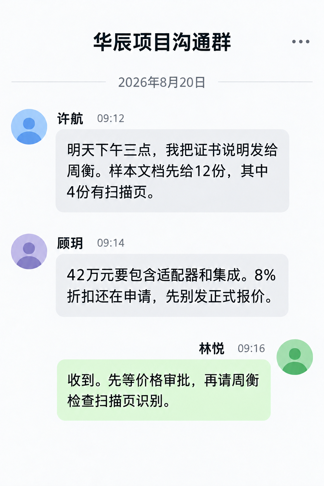

# 华辰精工八月销售跟进纪要

文档编号：SALES-001  
版本：1.0  
会议日期：2026-08-18  
记录日期：2026-08-18  
补充沟通日期：2026-08-20  
记录人：销售 林悦  
参会人：客户许航和顾玥 售前周衡 商务赵宁  
状态：内部跟进记录  
阅读范围：销售与售前

## 客户提出的问题

许航问：“七月份说两卡版够用，怎么现在变成四卡？是不是想卖贵一点？”周衡解释，七月为四请求和两千 tokens，八月为八请求和四千 tokens。TEST-001 的 A2-4K-8 没达到新的模型阶段指标，因此 SOL-001 不能继续作为当前配置依据。

顾玥说：“我们总共四十二万，不是机器四十二万再加服务费。工务通今年也不会升级。”林悦确认预算必须包括旧版适配器与一次集成。标准目录价总额 442000 元超出预算，需要提出折扣申请，不能默认省去适配器。

## 尚未解决的事项

许航尚未提供网络证书配置和正式样本文档，完整应用首 token 延迟还未测量。他希望“大家用起来不卡”，但没有要求所有六十名注册用户同时生成；八请求口径仍以 CUST-001 为准。

顾玥表示需看到正式报价后再提交内部采购审批，没有承诺一定购买。林悦还未申请获批设备折扣。

## 行动记录

| 事项 | 负责人 | 计划日期 | 截至会议时的状态 |
| --- | --- | --- | --- |
| 提交设备 8% 折扣申请 | 林悦 | 2026-08-19 | 待提交 |
| 提供网络证书说明及样本文档 | 许航 | 2026-08-21 | 待客户提供 |
| 安排完整应用验证 | 周衡 | 材料到齐后确定 | 尚未安排具体日期 |
| 核对交期与服务范围 | 赵宁 | 正式报价前 | 待库存与审批结果 |

后续 2026-08-19 的价格申请见 BIZ-003。该文件仍是待审批申请，不应把本纪要中的行动计划改写为行动已经完成。

## 项目群补充沟通

附 2026-08-20 项目群沟通记录。群聊中的材料发送安排是计划，价格申请仍需按正式审批记录确认。

相关资料：CUST-001、SOL-001、SOL-002、TEST-001、BIZ-003。
