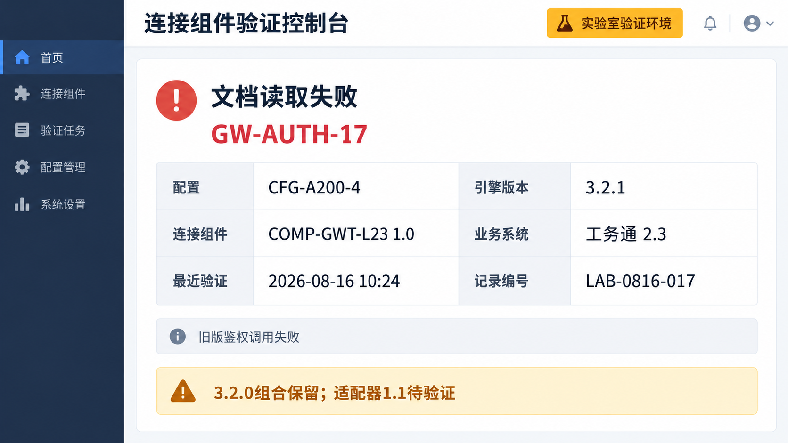

# 推理引擎升级与旧版适配器销售沟通通知

文档编号：SALES-003  
版本：1.0  
发布日期：2026-08-16  
负责人：研发 杜峻  
状态：升级风险待关闭  
阅读范围：销售与售前

## 发现的问题

澄算推理引擎 3.2.1 升级包调整了连接组件的鉴权调用。研发在 CFG-A200-4、工务通 2.3、COMP-GWT-L23 1.0 组合中复现了读取请求鉴权失败，错误标识为 GW-AUTH-17。

问题记录 ISSUE-017 指向 COMP-GWT-L23 1.0 与引擎 3.2.1 的组合。该记录没有表明设备硬件损坏，也没有证明所有旧版适配器部署已发生故障。

## 实验室验证界面

以下为研发验证控制台的故障记录。界面中的配置、组件版本、时间和记录编号用于核对验证条件，不能视为客户现场已经发生故障的凭证。

## 处置范围

使用或计划使用 COMP-GWT-L23 1.0 的项目，应暂停自动升级到引擎 3.2.1，并核对项目实际版本。现有引擎 3.2.0 组合按 PROD-003 和 TEST-003 的范围保留，不得从本通知推断有其他安全或性能保证。

COMP-GWT-S30 2.0 的鉴权链路不同，研发在 CFG-A200-4 与工务通 3.0 的复测中未复现上述错误。本通知不是对所有硬件配置的完整升级认证。

## 修复计划

COMP-GWT-L23 1.1 已进入研发计划，尚未完成与引擎 3.2.1 的验证，没有可对外承诺的发布日期。销售不得用“新适配器已经解决”回应客户。

若项目已经升级并出现错误，应记录当前版本、错误日志和升级前配置，由技术支持评估恢复方案；该通知不授权销售自行修改客户环境。

## 销售需要核查的信息

需要从商机方案或部署记录中找出连接组件、组件版本和引擎版本，再区分已部署项目与计划采购项目。只检索“一体机升级失败”或只按 A200 系列筛选，会遗漏使用旧版适配器的项目或误报其他项目。

项目负责人应核实情况后再决定是否沟通。通知不列客户名单，客户与组件的对应关系保存在各商机、方案和报价记录中。

相关资料：PROD-003、TEST-003。
